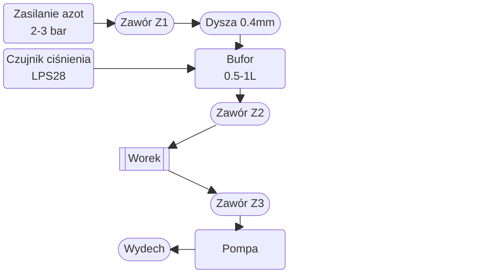
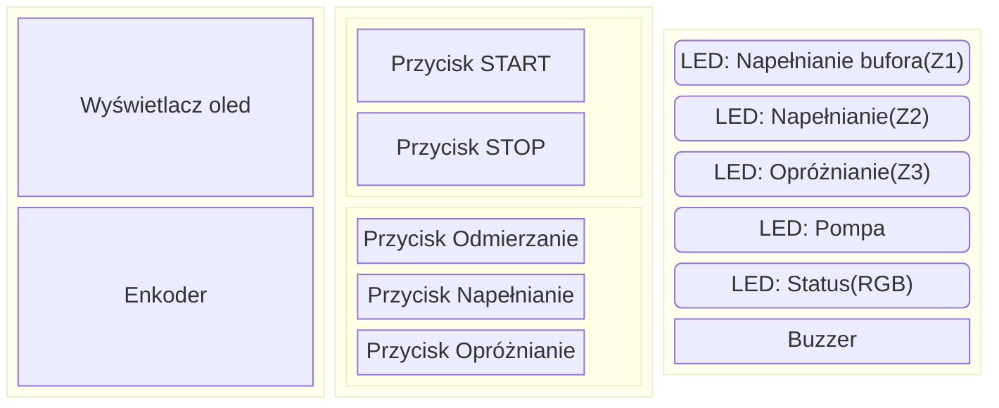

Schemat układu pneumatycznego:

Układ panelu sterowania:

Dokładna lista części
- Układ pneumatyczny(rurki 6mm pominięte w liście)
    - Zasilanie z butli: szybkozłączka z wyjściem na rurkę 6mm
    - 3x Zawór 12V
    - 1x Złącze wtykowe proste z gwintem **wewnętrznym** M6: https://allegro.pl/produkt/zlaczka-wtykowa-prosta-6-mm-m6-gw-nikiel-e368bc6c-3f75-4f79-8020-2c7dd378f88e?offerId=18839428709
    - Dysza do drukarki 3D z gwintem M6 0.4mm 
    - Bufor 0.5-1L
    - 4x złączka wtykowa grodziowa 6mm z uszczelką(wejście i wyjście z bufora, wyprowadzenie na worek w obudowie, wyprowadzenie na zasilanie w obudowie): https://allegro.pl/produkt/zlaczka-wtykowa-prosta-grodziowa-gpm6-6-6-mm-4892cca5-9d2e-474d-afe5-f1b9e8b2e86f?offerId=8972271434 
    - 1x złączka wtykowa grodziowa 4mm z uszczelką(wyjście na czujnik): https://allegro.pl/produkt/zlaczka-wtykowa-prosta-grodziowa-airtac-gpm4-4-4-mm-a2ac566b-a925-438d-8eae-281bd34b9783
    - Trójnik(Z2, worek, Z3)
    - Pompa 12V
- Elektronika:
    - Raspberry Pi Pico
    - Wyświetlacz OLED SSD1306 128x64
    - Enkoder obrotowy z przyciskiem
    - 2x przycisk 12mm (START + STOP)
    - 3x przycisk 6mm (Odmierzanie, napełnianie, opróżnianie)
    - 4x dioda LED 5mm (2x zielona napełnianie, 1x czerwona opróźnianie, 1x niebieska pompa)
    - 1x dioda LED RGB (status)
    - Buzzer pasywny
    - Zasilacz 12V 3A(pompa 500mA + elektronika 500mA + zawory 2A)
    - Przetwornica step-down na 5V
    - 4x N-MOSFET(3 zawory + pompa)

